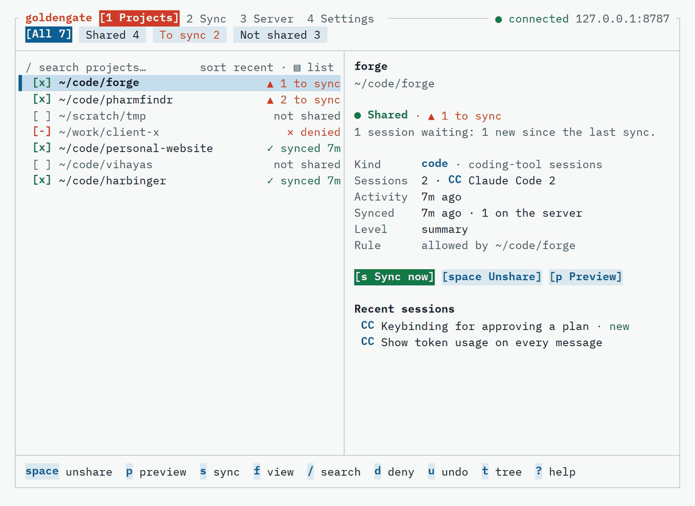

<p align="center">
  
</p>

<h1 align="center">Golden Gate</h1>

<p align="center"><em>A bridge you can see across.</em><br>Choose what your assistant knows.</p>

<p align="center">
  <a href="https://github.com/divyanshusingh2903/goldengate/actions/workflows/ci.yml"></a>
  <a href="LICENSE"></a>
  
  
</p>

<p align="center">
  <picture>
    <source media="(prefers-color-scheme: dark)" srcset="docs/brand/walkthrough-dark.gif">
    
  </picture>
</p>

Let a remote AI assistant know what you have been working on in your coding tools, with **you choosing which projects are shared**.

- `goldengate` (laptop): reads your local session history, applies your allow/block choices, redacts and summarizes, and sends to your own server.
- `goldengatebridge` (server you run): stores the summaries and serves them read-only over MCP.

Nothing leaves your computer until you approve it, raw transcripts are never sent, and every screen shows exactly what would go.

## Get started

```bash
go install github.com/divyanshusingh2903/goldengate/cmd/goldengate@v1.2.0
goldengate ui        # setup, projects, preview and send, in your browser
```

Prebuilt binaries for Linux, macOS and Windows are on the [releases page](https://github.com/divyanshusingh2903/goldengate/releases). The server is a Docker image: `ghcr.io/divyanshusingh2903/goldengatebridge`.

**Quickstart, docs and use cases: [divyanshusingh.site/goldengate](https://divyanshusingh.site/goldengate)**

| | |
|---|---|
| [Docs and quickstart](https://divyanshusingh.site/goldengate/docs) | install, run the server, connect your laptop and an assistant |
| [MCP](https://divyanshusingh.site/goldengate/mcp) | the tools an assistant gets |
| [Security](https://divyanshusingh.site/goldengate/security) | what is redacted, what is never sent, the threat model ([SECURITY.md](SECURITY.md)) |
| [Reference](docs/REFERENCE.md) | every command and screen, in the repository |
| [User guide](docs/GUIDE.md) | a full walkthrough on one computer |
| [Design](DESIGN.md) | product principles and architecture |

Sources: Claude Code, Codex, OpenCode, Cursor, and claude.ai / ChatGPT data exports. Status: beta.

## Development

```bash
make check          # vet, race tests, staticcheck, golangci-lint
govulncheck ./...
```

Enable the pre-commit hook with `git config core.hooksPath .githooks`; it blocks secret-shaped strings, real home paths, `.env` files and raw transcripts. Never commit real session data.

## License

[Apache License 2.0](LICENSE). Copyright 2026 Divyanshu Singh. The name, logo and brand guide live in [docs/brand](docs/brand/BRAND.md).
