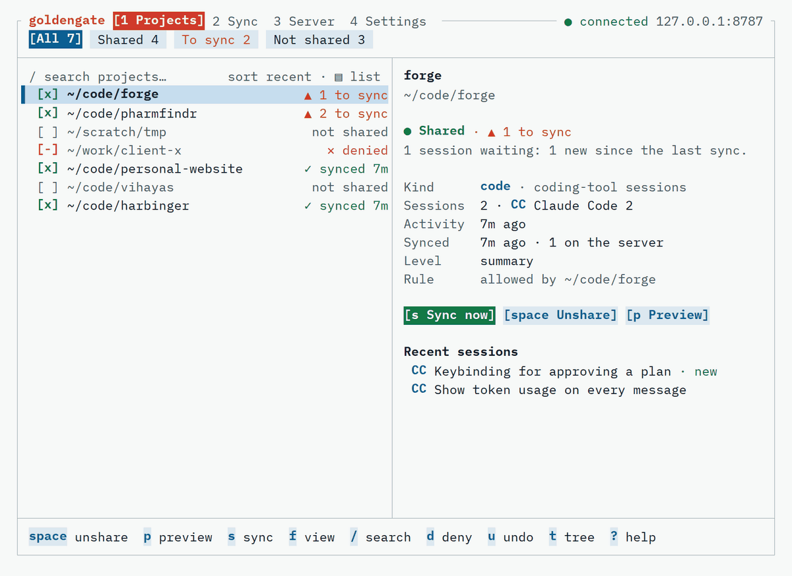

<p align="center">
  
</p>

<h1 align="center">Golden Gate</h1>

<p align="center"><em>A bridge you can see across.</em><br>Choose what your assistant knows.</p>

<p align="center">
  <a href="https://github.com/divyanshusingh2903/goldengate/actions/workflows/ci.yml"></a>
  <a href="LICENSE"></a>
  
  
</p>

<p align="center">
  <picture>
    <source media="(prefers-color-scheme: dark)" srcset="docs/brand/walkthrough-dark.gif">
    
  </picture>
</p>

Let a remote AI assistant know what you have been working on in your coding tools, with **you choosing which projects are shared**.

- `goldengate` (laptop): reads your local session history, applies your allow/deny choices, redacts and summarizes, and pushes to your own server.
- `goldengatebridge` (server you run): stores the summaries and serves them read-only over MCP (streamable HTTP, stateless JSON).

Status: pre-release (M4). Sources: Claude Code, Codex, OpenCode, and claude.ai / ChatGPT data exports. Deployment scripts and release packaging are on the roadmap in [DESIGN.md](DESIGN.md). See [SECURITY.md](SECURITY.md) before connecting an assistant.

## Quickstart (about ten minutes)

1. **Run the server** behind HTTPS. Generate the admin secret once and keep it:

   ```bash
   export GOLDENGATE_ADMIN_TOKEN="$(openssl rand -base64 32)"
   goldengatebridge serve --addr :8080 --behind-tls-proxy --db /data/bridge.db
   ```

2. **Connect your laptop.** Paste the admin secret when asked (it is never written to disk):

   ```bash
   goldengate init --server https://bridge.example.com
   ```

   This stores an `ingest` token in your OS keyring and prints a `read` token **once**. On a server where you have a shell you can pair instead: run `goldengatebridge pair` there and `goldengate init --server URL --pair-code CODE` here.

3. **Choose what to share, preview, sync:**

   ```bash
   goldengate share add ~/code/myproject
   goldengate sync --dry-run     # exactly what would be sent
   goldengate sync
   ```

4. **Connect the assistant.**
   - If its connector lets you set a header: use `https://bridge.example.com/mcp` and send the read token as `Authorization: Bearer <token>`.
   - If it only supports OAuth (Gemini's custom apps do; it supports dynamic client registration): start the server with `--oauth --public-url https://bridge.example.com`, then add `https://bridge.example.com/mcp` as the connector URL (Gemini: Settings > Connected Apps > Add a custom app). A consent page opens; approve it with your admin secret. No token to paste. If the assistant asks for a client ID and secret instead, run `goldengatebridge oauth clients create --redirect-uri <the address it shows>`.
   - Revoke a connected assistant with `goldengatebridge oauth clients delete <id>`.

Un-share with `goldengate share remove ~/code/myproject --purge-remote`. Rotate the assistant's token with `goldengate token rotate read`.

## The interactive UI

Run `goldengate` in a terminal. The first run starts a short setup (find your tools, connect to your server, choose the share level, pick projects, review, first sync); after that it opens the project picker.

| Screen | What it does |
|---|---|
| Projects (`1`) | Every project folder, with its sync state: `▲ 3 to sync`, `✓ synced 2h`, `not shared`, `✕ denied`. Views: All / Shared / To sync / Not shared (`f`). `space` share or un-share · `v` range · `a`/`A` mark all/none · `d` deny · `u` undo · `e` choose which tools are sent · `/` search · `t` folder tree (space on a folder shares everything below it) · `o` sort · `p` preview · `P` paranoid (raw payloads) |
| Sync (`2`, or `s`) | Two steps. **Review** runs at once: every session is read and redacted exactly as it would be sent, and nothing leaves the machine. **Send** (`enter`) sends exactly what was reviewed. Progress follows each session; a failed project can be retried and skips what already arrived. |
| Server (`3`) | Health, token check, what the server holds (code or chat), `D` delete a project from it |
| Settings (`4`) | Theme, share level, look-back window, sources, redaction patterns, commit verification |

The card beside the list says in words what happens to the highlighted project: "Not shared: nothing from this project leaves your machine", "Shared · never synced", "Shared · up to date". Every project and session carries the tag of the tool it came from: `CC` Claude Code, `CX` Codex, `OC` OpenCode (coding sessions), `AI` claude.ai, `GPT` ChatGPT (chat exports).

The preview is the exact outgoing payload, redactions marked, with what changed since the last sync. `?` shows every key. It works at 80x24 and follows resizes.

**Mouse.** Click a row to select it, click its `[ ]` box to share it, double-click to preview, ctrl+click to mark. Tabs, view chips, buttons, settings and the keys in the bottom bar are all clickable, and the wheel scrolls.

**Themes.** Golden Gate Light (default) and Dark, plus GitHub, Gruvbox, Catppuccin and Solarized (light and dark), Dracula, Monokai, Nord and Tokyo Night. Pick one under Settings → Theme (a dropdown that previews as you move); it is saved as `[ui] theme` in the config. `GOLDENGATE_THEME=gruvbox-dark` overrides it for one run. While the UI runs it sets the terminal's background to the theme's and restores yours on exit. `NO_COLOR` turns color off; nothing relies on color alone.

**Summaries.** Each session is summarized on your machine before anything is sent: a title, goals, what was done, outcomes (tests, commits, PRs), the first and last message, files touched and command names. Raw transcripts, tool output and file contents are never sent. By default fixed rules write the summary. For better summaries of sessions that cover several tasks, you can opt in to a small model; it then receives the redacted conversation of shared projects only. See [SECURITY.md](SECURITY.md).

Everything is in the TUI: **Settings → Summarizer** opens a dropdown (it asks before turning a model on), then the rows below it set the model, the endpoint, the API key (typed hidden, stored in the OS keyring) and run a test call.

| Choice | Default model | Key |
|---|---|---|
| Local heuristic (default) | none | none |
| Anthropic API (Claude) | `claude-haiku-5-5` | `ANTHROPIC_API_KEY` or keyring |
| OpenAI API (ChatGPT) | `gpt-5.4-nano` | `OPENAI_API_KEY` or keyring |
| Google Gemini API | `gemini-3.5-flash-lite` | `GEMINI_API_KEY` or keyring |
| OpenCode Zen API | `glm-5.3-flash` | `OPENCODE_API_KEY` or keyring |
| Custom, any OpenAI-compatible endpoint (Ollama, LM Studio, OpenRouter, …) | `llama3.2` at `http://localhost:11434/v1` | optional: `GOLDENGATE_SUMMARIZER_KEY` or keyring |

Model names change often: every default can be overridden, and "Test connection" tells you at once whether it works. The same from the command line:

```bash
goldengate summarizer use gemini --model gemini-3.5-flash-lite
goldengate summarizer set-key gemini
goldengate summarizer test                    # one tiny sample call (not your data)
goldengate summarizer use custom --base-url http://localhost:1234/v1 --model qwen3
goldengate summarizer use heuristic           # back to local rules
goldengate sync --resummarize                 # also upgrade sessions already synced with the rules
```

A session is summarized once per content: answers are cached, and an unchanged session is not sent to the model again.

Turning a model on only affects new and changed sessions. Sessions synced earlier keep their rule-based summaries until you ask: `goldengate sync --resummarize` (or, on the Sync screen, the "N synced sessions have rule-based summaries" line and its **Include them in this sync** button) rebuilds them and sends their redacted conversations to the model. Only sessions whose summary actually changes are pushed again.

Everything the UI does is also available as a command.

The tools sent for one project can be chosen with `e`: on a shared project, untick a tool to stop sending it; on one that is not shared yet, ticking a tool shares the project with only that tool. That is stored as `deny_source = ["codex@~/code/app"]` in the config.

## Sources

| Source | How it is read |
|---|---|
| Claude Code | `~/.claude/projects/**.jsonl` (honors `CLAUDE_CONFIG_DIR`) |
| Codex CLI / Desktop | `~/.codex/sessions/**/rollout-*.jsonl` (honors `CODEX_HOME`) |
| OpenCode | its SQLite database, read-only (`$XDG_DATA_HOME/opencode/opencode.db`) |
| claude.ai | `goldengate import-claude-ai export.zip` |
| ChatGPT | `goldengate import-chatgpt export.zip` |

The same folder in several tools is one project. Worktrees are filed under their repository when it is selected. Chat exports become projects like `claude-ai:Chats` and are shared only with an explicit `goldengate share add 'claude-ai:Chats'` (globs work: `chatgpt:*`). Exports stay where you keep them; `goldengate imports list|remove` manages them.

## Development

```bash
make check          # vet, race tests, staticcheck, golangci-lint
govulncheck ./...
```

The pre-commit hook (`git config core.hooksPath .githooks`) blocks secret-shaped strings, real home paths, `.env` files and raw transcripts. Test fixtures are synthetic or scrubbed; never commit real session data.

## License

Golden Gate is licensed under the [Apache License 2.0](LICENSE). Copyright 2026 Divyanshu Singh.

The name, logo and brand guide live in [docs/brand](docs/brand/BRAND.md).
